# 虚拟存储器

## 一、 为什么需要虚拟地址？

1. 一个程序的程序段、数据段和堆栈的总大小可以超过实际的物理内存大小，os把当前使用的部分放到物理内存中，其他未使用的部分放到更下一级存储器（如disk/flash）。物理内存可以小于虚拟内存，虚拟内存大小的上限取决于处理器总线宽度，所以说“一个程序是运行在虚拟存储器空间的。”  
2. 实现了程序的隔离。如果直接使用物理内存，每一个程序需要分配一块地址空间，这限制了程序的编写。使用虚拟内存后可以不用考虑地址的限制，每个程序都认为处理器中只有自己在运行。
3. 实现了程序的隔离和保护。使用相同的虚拟地址会对应到不同的物理地址，这样程序的内容不会被其他程序随意改写。如果程序A和程序B都是用printf函数，os在地址转换的时候会转换为相同的物理地址（既printf在物理存储器中的实际地址）。这样降低了容量需求。

## 二、地址转换

1. 虚拟地址空间以页划分，典型大小为 4kb。对应的物理内存以同样大小划分，叫做帧（frame）。当程序开始运行时，把需要的部分从硬盘中以页大小搬运到物理内存中，使得处理器可以运行比物理内存大的程序。对于一个页为4kb的虚拟地址VA，低十二位表示页内偏移量。剩余部分表示页号。对于一个物理地址，低十二位表示帧内偏移量。剩余部分表示帧号。由于页大小和帧大小一样，所以从VA到PA的过程就是页号到帧号的映射变换过程。
2. 当虚拟内存大于物理内存时，当mmu发现一个虚拟地址没有被映射后，会产生一个page fault的异常给处理器。处理器执行异常程序后从物理内存中找到一个帧解除映射关系，然后把需要的内容从硬盘搬运到物理内存中，并绑定映射。如果被替换的帧是dirty的，需要先将他的内容搬运会硬盘再解绑。

### 单级页表

&emsp;&emsp;页表（page table）：用来存储虚拟地址到物理地址的对应关系的一张表格，存放在物理内存中。每个程序都有自己的页表。
&emsp;&emsp;页表寄存器（page table register）：为了只是一个程序的页表在物理内存中的位置，用页表寄存器来存放当前运行程序的页表在物理内存中的起始位置。

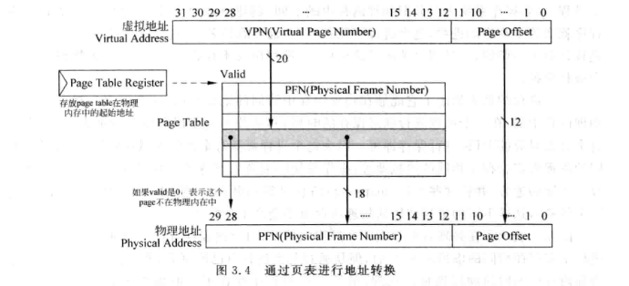

单极页表的问题：

- &emsp;&emsp;一个32位处理器，页大小是4KB，页表中每个表项大小为4字节的结构，那么页表中需要的表项个数是 4GB / 4KB = 2^20，作为页表的大小是4B * 2^20 = 4MB。也就是说，对于在处理器中中运行的每一个进程，都需要在物理内存中为其分配连续4MB大小的空间来存储页表。如果只有一个进程是ok的，但是当进程逗乐以后，就是不可能的了。
- &emsp;&emsp;而且一个程序很难完整用满4GB的虚拟存储器空间，大部分只有了很少一部分，导致页表中大部分内容是空的，没有被实际利用。利用率很低。
- &emsp;&emsp;解决方案就是多级页表。

### 多级页表

&emsp;&emsp;将 4MB 的线性页表划分为若干更小的子页表，这样就不用把整个线性表都放入物理内存中，而是有需求地放入这些子页表。而且子页表不再需要占用连续物理空间，提高了利用率。

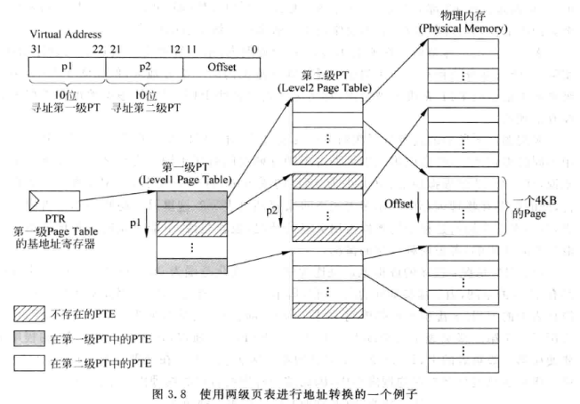
几种情况：

1. 理想情况，一个程序连续占用了一片虚拟地址空间。只用开一个二级页表。
2. 最坏情况，一个程序的地址分别跳跃地占据了每一个4KB页的一部分，导致运行一个程序需要开所有的二级页表。

通过增加级数，可以把子页表大小切的更小，从而减少页表（无用部分）对物理内存的占用。

### page fault

&emsp;&emsp;在访问页表时，如果对应的pte（page table entry）的valid位是0，就会触发page fault，需要从下级存储器把页取出来放到对应的物理内存。
&emsp;&emsp;page fault是异常的一种，处理过程由软件（os）而不是硬件完成。

- page fault需要访问硬盘，时间很长，即使对应的异常程序几百条指令，与硬盘访问时间相比也是微乎其微的，因此没必要用硬件

- 发生page fault需要把一个或几个页放到物理内存中，用软件可以根据实际情况实现灵活的替换算法。

&emsp;&emsp;操作系统会在硬盘中为一个硬盘的所有页开辟一个空间，在这个空间叫swap空间。在开辟swap空间的同时，还用一个表格记录每一个页在硬盘的位置。

&emsp;&emsp;os在执行替换算法的时候使用lru算法，需要硬件支持一位叫“使用位”，在该页被访问时置1，os周期性清零。这样就知道哪个页最近被使用过。
&emsp;&emsp;写回类型的cache中load/store指令执行时只会对D-cache起作用，对物理内存页表的状态更新存在延迟，当os要查询这些状态位时，需要将D-cache的内容更新到物理内存中，才能正确使用状态位。
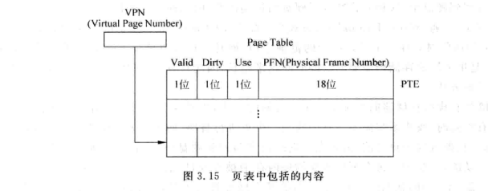

## 程序保护

为了实现程序的保护与共享，需要os和用户进程对不同页有不同的访问权限。这是通过页表的状态位实现的。

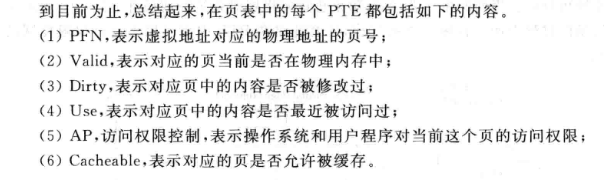

如果D-cache送出的虚拟地址并不是访问物理内存，而是访问芯片的外设，这些地址是不被允许经过D-cache缓存的。因为如果被缓存了，那么这些读写操作将只会在D-cache中起作用，不会传递到外设寄存器中。因此处理器存储器映射中，有一块区域是uncacheed的。

## 加入TLB和Cache

### TLB设计

&emsp;&emsp;TLB(Translation Lookaside Buffer)：存储了页表中最近被使用过的PTE，从本质上来说TLB就是页表的Cache。但是它只有时间相关性，而没有Cache的空间相关性。

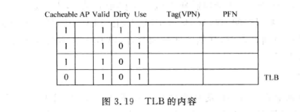

&emsp;&emsp;现代处理器都是支持大小可变的页,避免产生过多的页内碎片.TLB需要相应的位来映射页大小。

&emsp;&emsp;TLB缺失的几种情况:

1. 虚拟地址对应的页不在物理内存中，页表中不存在PTE。
2. 虚拟地址和物理地址的映射关系存在于页表，但是不在TLB中。

解决方法：

1. 软件处理
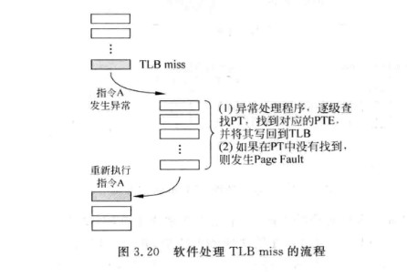
需要将流水线排空，执行异常处理程序，然后再指令放回流水线。

2. 硬件处理：
硬件MMU从多级页表里通过一个状态机，逐级查找。如果发现PTE无效，触发Page fault异常，os介入。硬件处理的方法适合超标量处理器，因为不用打断流水线。

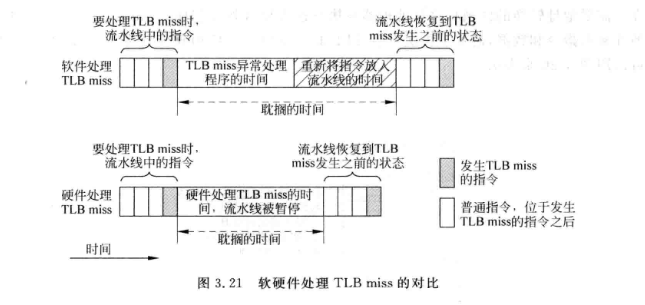

对TLB进行控制：
1. 
2. 
3. 

### cache的设计

要先经过TLB在访问物理cache，必然要增加流水线延迟，如果TLB单独使用一级流水线，但是就增加了分支失败的乘法和load指令延迟

如果在虚拟cache种找到了需要的数据，就不需要访问TLB和物理内存，不会对时钟周期产生负面，但是会增加硬件开销。具体原因为

1. 同义/重名（aliasing）问题
&emsp;&emsp;多个不同名字对应相同的物理位置，虚拟存储系统中，一个进程内/不同进程间，不同的虚拟地址可以对应同一个物理内存的位置。可能在cache中，不同的虚拟内存对应同一个物理位置，造成了cache空间的浪费，以及在store指令写数据到cache中时，需要将cache中所有指向同一物理地址的地方都做修改。  
&emsp;&emsp;也不是所有虚拟cache会出现重名问题，这和页大小和cache大小有关。一个大小为 4KB 的页，有一个容量小于 4KB 的直接相连cache，由于物理地址和虚拟地址的页内偏移一样，所以即使两个虚拟地址对应一个物理地址，但是也只会占据cache一个位置。
&emsp;&emsp;解决方法：将整个cache以 4KB 分为若干bank，根据物理地址部分位宽指定写入到哪个bank中。本质思想是bank间用物理地址选择，bank内用页内偏移量选择。
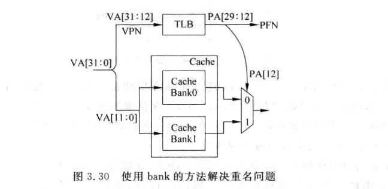

2. 同名问题
&emsp;&emsp;相同名字对应不同物理位置。每个进程都占用整个存储器空间，因此不同进程之间会存在很多相同的虚拟地址，经过转换后得到不同的物理地址。
&emsp;&emsp;问题是当从一个进程切换到另一个进程时，新进程使用虚拟地址来访问虚拟cache的话，从cache中可能得到上一个进程的虚拟地址对应的数据。
&emsp;&emsp;最简单的解决方法就是在进程切换的时候将虚拟cache和TLB中所有内容都置无效。  
&emsp;&emsp;每一个进程赋一个编号，每个进程产生的虚拟地址都附上这个编号（编号成为虚拟地址的一部分）。这个编号就叫PID or ASID。使用ASID相当于卓看了虚拟存储器空间。问题是当多个进程要共享一个页时，需要在ASID之外再增加一个标志位，GLOBAL位。
&emsp;&emsp;ASID和原来的虚拟地址组成了新的虚拟地址，相当虚拟地址位数增加了。
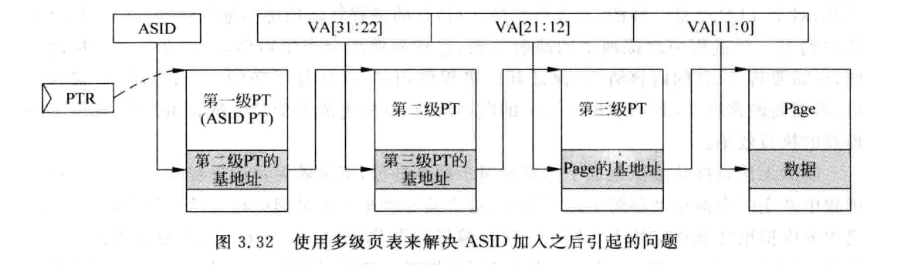

&emsp;&emsp;8位asid最多表示256个进程，超出之后，就挑出一个踢出，把这个asid分配给新进程，同时更新PTR,为了能对就进程进行恢复，os需要将被覆盖的寄存器ci进行保存。
&emsp;&emsp;使用asid，os就需要管理asid的使用，尤其是进程退出的进程，要收回asid。

### 对cache的控制

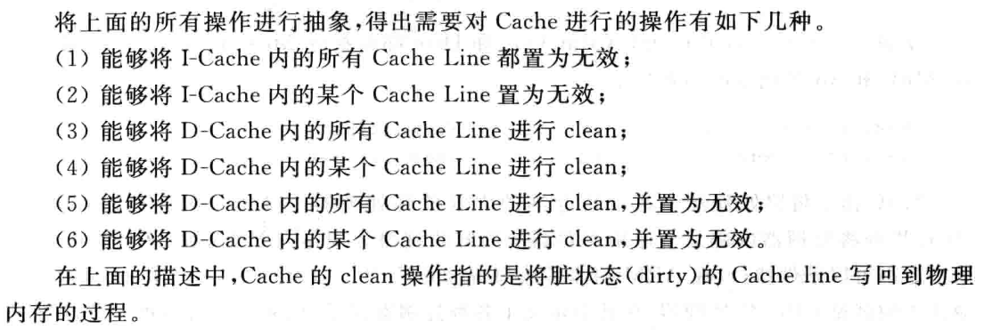

### 将 TLB 和 和 cache 放入流水线

1. Physically-indexed，Physical-Tagged
先经过 TLB 得到 PA 再经过 Cache 是一种保守的做法。
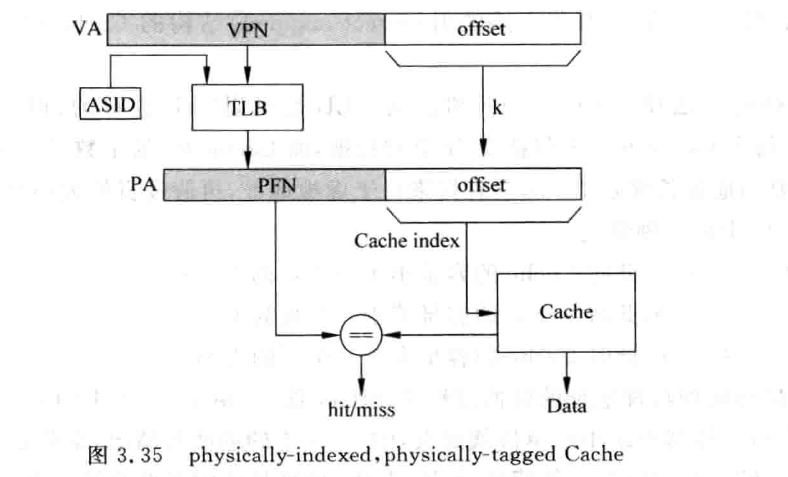
问题是寻址TLB需要时间，为了避免这个负面影响，需要将访问 TLB 单独作为流水线。对于I-cache来说，会增加分支预测乘法；对于D-cache来说，会增加load指令延迟。

2. Virtually-Indexed，Physically-Tagged
这种方式使用虚拟cache，根据cache大小，直接用虚拟地址的一部分来寻址（virtually-indexed），但是tag则使用物理地址的PFN。这样访问cahce和TLB是并行的。
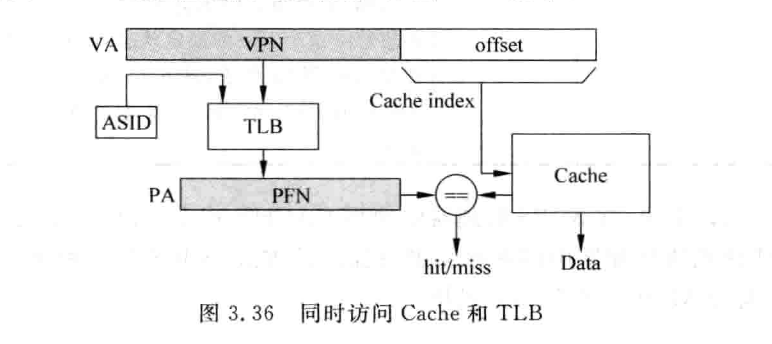

如果页面大小需要k个位表示。寻址cache需要L+B个位，l用于寻址cache line，用来访问每个cache line中的字节，那么会有两种情况。

- 第一种情况：k >= l + b; 也就是cache的容量小于等于一个页的大小，可以直接用虚拟地址中页内偏移的部分来寻址，本质是使用物理地址寻址。这样可以避免cache重名问题。用于比较的 ta g需要经过 TLB 得到，访问 TLB 和 Cache是同步进行的，这样可以在一个周器内完成。使用这种方法的直接映射 cache ，它的大小被限制到页面大小，通常为 4KB。要想获得更大的 Cache， 需要使用组相联结构，因为增加way个数不会引起寻址地址位数的增加。比如 32KB 的Cache，就需要8-way设计。本质就是多个纵向的直接映射结构并联。
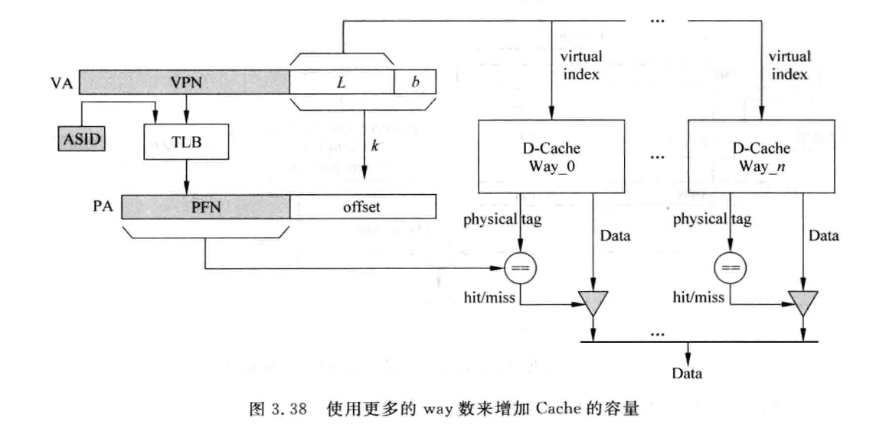

- 第二种情况：k < l + b;会出现重名的情况。使用 bank 结构来将所有重名虚拟地址分门别类地存放到 Cache中的指定地方。还有一种方法是采用 inclusive L2 Cache方法。L2 Cache包含L1 Cache
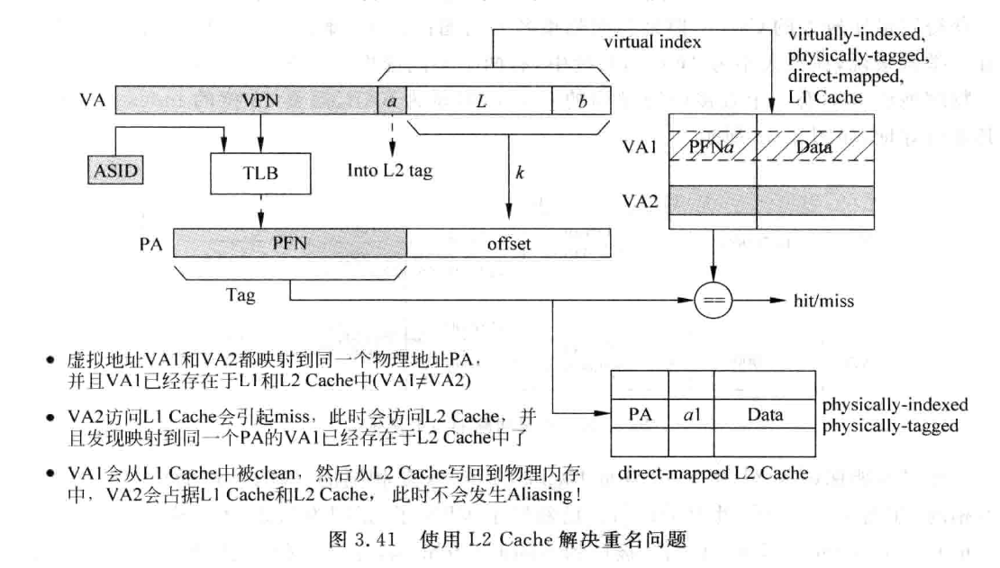
因为 L2 Cache里包含了 L1 的所有信息，所以在 L2 每个Cache line中存储超出页面大小位宽的部分a。因为 L2 都是物理地址寻址的，所以当发现 VA2 以物理地址在 L2 中访问时，会发现这个物理地址已经存在L2中，并且这个 PA 对应的 a 和 VA2 的a不同，那么就应该用 PA 的 a 拼接上 VA2 的页内偏移部分位，再去 L1 中寻找并把它无效掉，然后把 VA2 数据从 L2中读到 L1。相当于在有两个重名的 VA 时，会clean or 无效掉 VA1 ，在 L1 中只保存 VA2。

3. virtually-indexed， virtually-tagged
使用虚拟地址来寻址，并使用虚拟地址作为tag。如果发生确实，就需要通过 TLB 的到物理地址，然后去寻址 L2 等下层 Cache。但是这样还是存在重名问题。解决方案和上面的Virtually-Indexed，Physically-Tagged k < l + b一样。只不过不能在 L2 中存储虚拟地址的 a 部分，而是应该存储整个虚拟地址。处理方式也是先将 L1 中的 VA1 对应的 Cache line 置为无效，如果是脏状态，那么需要 clean 操作。