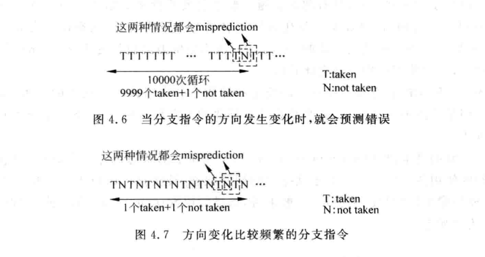
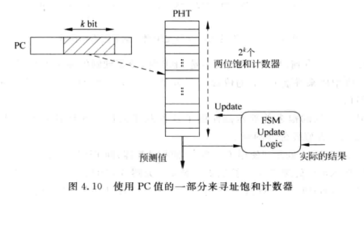
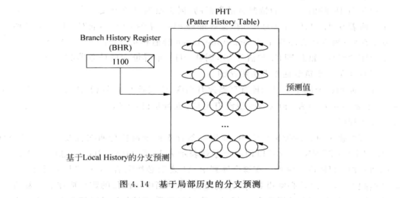

# 分支预测

分支指令包含两个要素：

1. 方向
2. 目标地址

- 直接跳转
- 间接跳转

注：对于流水线不深的mips处理器，可以用延迟槽，在分支指令后添加不相关的指令减少惩罚。

通过I-cache的快速解码识别分支指令。
可以通过取指令的地址进行分支预测。

## 分支指令的方向预测

### last-outcome prediction

### 基于2bit饱和计数器的分支预测

使用格雷码对状态机进行编码，可以降低出错概率并降低功耗。  
分支预测都是基于PC进行的，每个PC都对应一个2bit饱和计数器。  
PHT（pattern history table）：是一个表格，存个所有PC值的饱和计数器值，使用PC的一部分来寻址。

有三个时间点可以对PHT更新：

1. 流水线取指令阶段，进行分支预测时，根据预测结果更新PHT
2. 流水线执行阶段，当分支方向被实际计算出来。
3. 流水线提交阶段，当分支指令离开流水线时。

第一种方法不适用，因为此时的结果可能是错的。  
第二种方法如果在乱序中，执行阶段结果也不一定正确，因为这条分支指令很可能在分支预测失败的路径上。  
第三种方法更新时万无一失的，但是这种基于2bit饱和计数器的方法上限最高98%。现代处理器不直接使用。  

### 基于局部历史的分支预测

根据PC的部分位作为index对BHT（branch history table）进行索引，得到一个BTR（branch history register）,通过BTR再索引PHT得到饱和计数器。  

使PHT达到饱和状态的时间称为训练时间，位宽大的BHR寄存器训练时间更长，需要的PHT越多，但是记录的历史信息更多，精确度更高。  
如果一个序列中，连续相同的数最多有p位，那么这个序列的循环周期就是p，只要BHR的宽度n小于序列循环周期p，就可以完美预测。  
理想情况是如果每一个n位宽度BHR都对应2^4的PHT的话，需要的存储空间太大。现实情况是所有分支指令只是用一个PHT。
带来两种冲突：

1. 两条分支指令PC的截取部分相同，此时会所引到同一个BHR，也就对应到PHT中的同一个饱和计数器
2. 两条分支指令对应两个不同BHR，但是两个BHR的内容一样，这样也会索引到PHT中的同一个饱和计数器

解决方法:

1. 对PC进行哈希处理，得到一个固定长度的值，以此值寻址BHT，解决上述冲突1
2. 对PC的一部分和BHR进行处理，得到的新值，寻址PHT，解决上述冲突2（包括拼接和异或）

基于 BHR 的分支预测方法只考虑当前分支自身过去的跳转历史，因此属于**局部历史预测**。从理论上看，只要 BHR 足够长，就能够记录较长的执行序列，从而识别分支的循环周期和重复规律，获得较高的预测准确率。

但实际处理器不能无限增加 BHR 的位宽。BHR 越长，所需的训练时间越长，同时用于保存不同历史模式对应预测状态的 PHT 规模也会迅速增大，带来较大的硬件开销。因此，现实中的处理器通常只采用有限位宽的 BHR，预测准确率也难以达到理论上的最佳水平。像999次跳转加1次不跳转，无法获得最完美的分支预测精准度。

此外，局部历史预测只关注某一条分支自身的过去行为，没有考虑不同分支之间的相关性。而在实际程序中，一条分支的结果有时会受到前面其他分支结果的影响，因此仅依靠局部历史仍存在一定局限。
